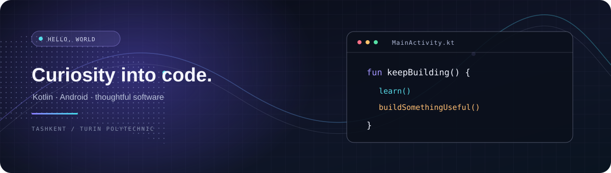

# Hi, I’m Muhammadaziz 👋

### Student · Building software projects

**Turin Polytechnic University in Tashkent**

---

## 👨‍💻 About Me

I’m a student at Turin Polytechnic University in Tashkent, exploring software development through coursework and hands-on projects. I enjoy learning how applications fit together and turning ideas into working software.

- 🎓 Studying at Turin Polytechnic University in Tashkent
- 💻 Building projects with Kotlin and exploring backend development
- 🌱 Always learning, one project at a time

## 🧰 Tech Stack

## 📊 GitHub Activity

 

## 🤝 Connect

---

*Thanks for visiting — feel free to explore my repositories.*

